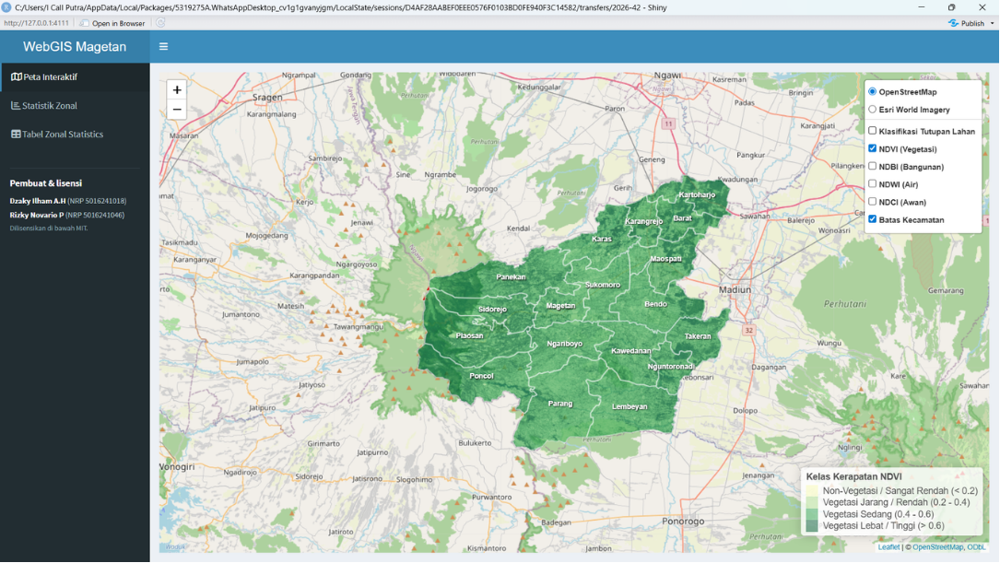
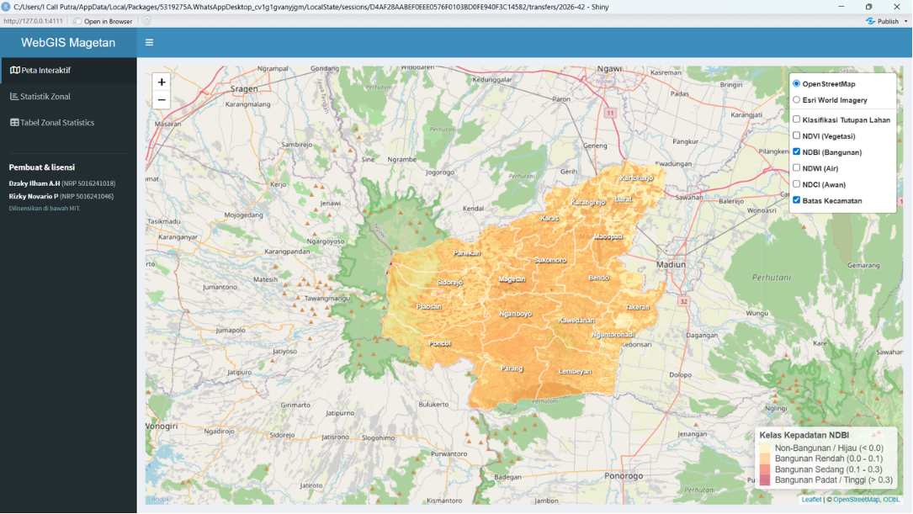
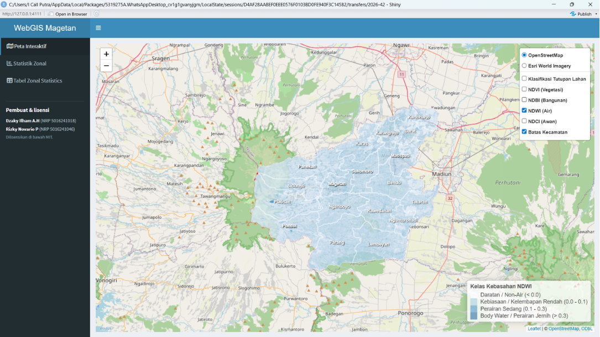
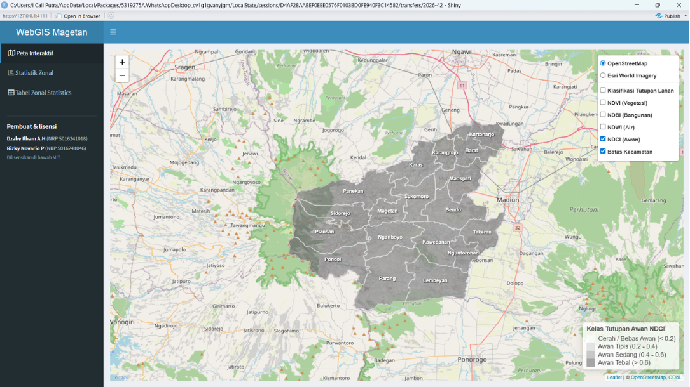
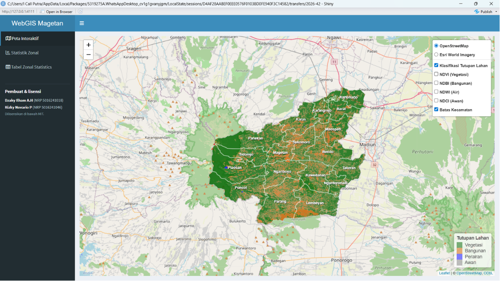

# WebGIS Indeks Spektral Kabupaten Magetan

**Dashboard WebGIS interaktif untuk visualisasi indeks spektral Sentinel-2 dan statistik zonal per kecamatan di Kabupaten Magetan.**

 

<a href="docs/01_peta_ndvi.png">Peta NDVI</a> ·
<a href="docs/02_peta_ndbi.png">NDBI</a> ·
<a href="docs/03_peta_ndwi.png">NDWI</a> ·
<a href="docs/04_peta_ndci.png">NDCI</a> ·
<a href="docs/05_peta_klasifikasi_tutupan_lahan.png">Tutupan Lahan</a> ·
<a href="#-memulai">Menjalankan</a> ·
<a href="#keterangan">Keterangan</a>

---

Kabupaten Magetan terletak di bagian barat Jawa Timur yang membentang di lereng timur Gunung Lawu. Karakteristik wilayahnya sangat khas: mulai dari kawasan pegunungan dan hutan tutupan lebat, pertanian/perkebunan hortikultura, badan air seperti Telaga Sarangan dan waduk, hingga kawasan pemukiman padat di dataran yang lebih rendah. Dashboard ini merangkum karakter geospasial tersebut menjadi **empat indeks spektral** dan **klasifikasi tutupan lahan** yang dapat dijelajahi langsung di peta, dilengkapi **statistik zonal per kecamatan** untuk menganalisis dan membandingkan wilayah secara objektif.

Hasil olahan indeks menampilkan pola tutupan lahan: NDVI untuk vegetasi, NDBI untuk kawasan terbangun, NDWI untuk badan air, NDCI untuk menandai awan, serta hasil klasifikasi komposit tutupan lahan.

## Daftar Isi

- [Tangkapan Layar](#-tangkapan-layar)
- [Fitur](#-fitur)
- [Indeks Spektral](#-indeks-spektral)
- [Keterangan](#keterangan)
- [Struktur Proyek](#-struktur-proyek)
- [Memulai](#-memulai)
- [Sumber Data](#-sumber-data)
- [Keluaran](#-keluaran)
- [Catatan](#-catatan)
- [Penulis](#-penulis)

## Tangkapan Layar

Tab **Peta Interaktif** menampilkan empat indeks spektral dan klasifikasi tutupan lahan yang dapat dinyalakan satu per satu:

| NDVI — vegetasi | NDBI — lahan terbangun |
|:---:|:---:|
|  |  |

| NDWI — perairan | NDCI — awan |
|:---:|:---:|
|  |  |

| Klasifikasi Komposit Tutupan Lahan |
|:---:|
|  |

## Fitur

- **Peta interaktif berbasis Leaflet** dengan pilihan variasi basemap: CARTO (Positron & Dark Matter), OpenStreetMap, dan citra satelit Esri World Imagery.
- **Empat indeks spektral & Klasifikasi Tutupan Lahan** yang dapat dinyalakan secara dinamis (NDVI, NDBI, NDWI, NDCI, Komposit Tutupan Lahan) dengan palet warna khusus geospasial.
- **Overlay batas & nama kecamatan** di Kabupaten Magetan yang dapat dinyalakan/dimatikan secara mandiri tanpa mengganggu indeks.
- **Popup nilai statistik per kecamatan** dan **sorotan wilayah (highlight)** interaktif langsung dari lokasi peta.
- **Statistik zonal interaktif**:
  - Filter **wilayah kecamatan** di seluruh Kabupaten Magetan.
  - Grafik peringkat kecamatan berbasis Plotly (dukungan hover & zoom).
  - Slider interaktif untuk menyaring kecamatan berdasarkan nilai rerata indeks.
  - Tabel data interaktif yang dapat diurutkan, dicari, dan dipaginasi (DT).
- **Sinkronisasi peta dan tabel**: Klik pada grafik atau tabel akan langsung memperbesar (*zoom*) dan menyorot kecamatan terkait pada peta.

## Indeks Spektral

| Indeks | Nama Lengkap | Rumus | Deskripsi |
|:------:|--------------|-------|-----------|
| **NDVI** | Normalized Difference Vegetation Index | `(B08 − B04) / (B08 + B04)` | Mengukur kerapatan dan kesehatan vegetasi; nilai tinggi menandakan kawasan hutan lereng Gunung Lawu dan lahan pertanian produktif. |
| **NDBI** | Normalized Difference Built-up Index | `(B11 − B08) / (B11 + B08)` | Menandai lahan terbangun seperti kawasan pemukiman perkotaan, fasilitas publik, dan jaringan jalan. |
| **NDWI** | Normalized Difference Water Index | `(B03 − B08) / (B03 + B08)` | Menandai keberadaan badan air: Telaga Sarangan, sungai, waduk, hingga lahan pertanian tergenang/irigasi. |
| **NDCI** | Normalized Difference Cloud Index | `(B04 − B08) / (B04 + B08)` | Menandai keberadaan tutupan awan pada citra sehingga dapat dipisahkan dari analisis daratan dan perairan. |

> Catatan Kanal (Sentinel-2 Level-2A, 10m): B03 = Green, B04 = Red, B08 = NIR, B11 = SWIR.

## Keterangan

| Kategori | Alat / Pustaka |
|----------|----------------|
| Bahasa & Lingkungan | R, RStudio |
| Framework Web | Shiny, shinydashboard |
| Peta Interaktif | Leaflet, leaflet.extras |
| Data Vektor | sf |
| Data Raster | terra, raster |
| Tabel & Grafik | DT, ggplot2, plotly |
| Manipulasi Data | dplyr |
| Backend Geospasial | GDAL, PROJ, GEOS |
| Sumber Citra | Sentinel-2 Level-2A (Resolusi 10 m) |

## Struktur Proyek
